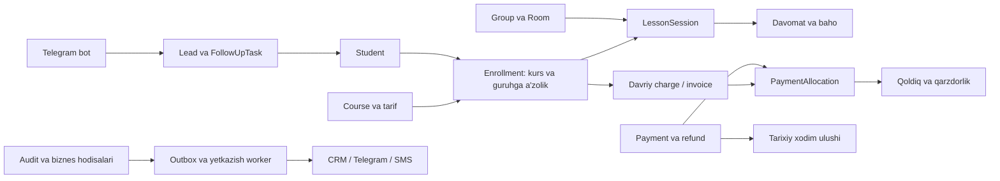

SargetCRM professional auditi — 2026-yil 29-oktabr

**Umumiy baho: 4,0/10.** Loyiha o'quv markazining qabul, o'quv jarayoni va moliyasini birlashtiradigan ishlaydigan dastlabki mahsulot. Biroq hozirgi kodda moliyaviy ma'lumotni yo'qotish, noto'g'ri qarzdorlik ko'rsatish va ruxsatsiz amallarga yo'l ochadigan kamchiliklar mavjud. Ularni tuzatmasdan mahsulotni keng ko'lamda joriy etish tavsiya etilmaydi. Bu ishlab chiquvchining malakasiga berilgan baho emas; mavjud nusxaning ekspluatatsiyaga tayyorligi bahosi.

**Audit doirasi va dalillar.** Django sozlamalari, modellar, migratsiyalar, barcha asosiy view va formalar, URLlar, ruxsatlar, admin paneli, HTML shablonlari, CSS/JavaScript, Telegram bot, eslatmalar va hujjatlar ko'rib chiqildi. Yakuniy `python manage.py test core` tekshiruvida **16 ta mavjud test o'tdi**. `makemigrations --check --dry-run` o'zgarish aniqlamadi. `check --deploy` lokal konfiguratsiyada **6 ta xavfsizlik ogohlantirishi** chiqardi. Qo'shimcha **24 ta audit ssenariysi, 25 ta natija yozuvi** faqat sun'iy ma'lumotli `:memory:` bazada tekshirildi. Ularning bajariladigan skripti: [audit_probe.py](audit_probe.py); natijasi: [audit_evidence_2026-10-29.json](audit_evidence_2026-10-29.json). Skriptni loyiha ildizidan `python docs/audit_probe.py` bilan qayta bajarish mumkin. Bu skript nuqsonlarni qayd etadigan audit vositasi; tuzatilgan tizim uchun regression testlar o'rnini bosmaydi.

Mavjud ishchi bazaning yozuvlari o'qilmadi yoki o'zgartirilmadi. Haqiqiy Telegram/SMS/to'lov provayderiga so'rov yuborilmadi. Brauzerda vizual ko'rinish, real telefon, screen reader, yuklama va production server tekshirilmagan. Mobil va accessibility xulosalari kod tahlili darajasida. Productionda HTTPS, backup yoki monitoring tashqaridan sozlangan bo'lishi mumkin; loyiha papkasida ularning tasdig'i topilmadi. Bu holat ularning serverda umuman yo'qligini isbotlamaydi.

Foydalanuvchi roziligiga ko'ra asosiy ssenariy — bitta markazning ichki CRM tizimi. Filiallar, o'quvchilar soni, real trafik, hozirgi tushum va SaaS sotish rejasi aniqlanmagan. Quyidagi ko'lam va muddatlar shu chegarada berilgan; ko'p markazli platforma talabi tasdiqlangan deb hisoblanmaydi.

**Biznes maqsadi va mavjud mahsulot.** Koddan ko'rinadigan qiymat zanjiri: Telegram/reklama murojaati → resepshn aloqasi → o'quvchiga aylantirish → guruhga biriktirish → davomat/baho → to'lov → xodim ulushi → rahbar hisoboti. CRMning o'zi uchun tarif, obuna yoki litsenziya sotish modeli kodda ko'rinmadi. Shuning uchun asosiy biznes foydasi markazning kurs to'lovlarini nazorat qilish, murojaatni yo'qotmaslik va xodim vaqtini tejash deb baholandi. Bu foydaning puldagi miqdori uchun real ma'lumot kerak.

| Yo'nalish | Mavjud imkoniyat | Tekshiruv natijasi |
| - | - | - |
| Hisoblar | Admin, o'qituvchi, resepshn; alohida dashboardlar | Rollar mavjud, lekin ruxsatsiz/default holat xavfsiz yopilmagan |
| Qabul | Lead, manba/kampaniya, holatlar, izoh, keyingi aloqa, tarix, CSV | Asosiy oqim bor; o'quvchiga o'tkazish va qayta eslatish chekka holatlari buzilgan |
| Telegram | Ism, familiya, kurs, telefon; kontakt; `/start`, `/cancel`; persistent suhbat | Serial takroriy update testlari bor; parallel yuborish va uzun uzilishlardan tiklanish kafolati yo'q |
| O'quvchilar | Rasm, aloqa, ota-ona telefoni, guruh, o'qituvchi, chegirma, status | Bir o'quvchi uchun bitta joriy guruh; guruh/o'qituvchi izchilligi majburlanmaydi |
| Jadval | Hafta kunlari, xona matni, vaqt, bugungi guruhlar | Alohida dars sessiyalari, bandlik konflikti va bayram kalendari yo'q |
| Davomat | 4 holat, guruh bo'yicha kiritish, sanali ro'yxat va statistika | Qayta ochilganda oldingi tanlovlar noto'g'ri o'qiladi; server noma'lum statusni qabul qiladi |
| Baholar | 1–100 ball, turi, sana, izoh, statistika, o'quvchi kartasi | Bazada tabiiy kalit unique emas; GET bilan o'chirish mumkin |
| Moliya | Naqd/karta/bank/o'tkazma, oylik to'lov, xarajat, foizli maosh/komissiya | Shartnoma/qarz yozuvi, taqsimot va qaytarim yo'q; tarix joriy holatga bog'liq |
| Analitika | Tushum/xarajat, davomat, qarzdorlar, manbalar, xodimlar | Grafik JSONi va oylar ketma-ketligi xato; ko'rsatkichlar ta'rifi to'liq emas |
| Operatsion ish | CRM bildirishnomasi, polling, scheduler buyrug'i | Buyruq bor; job ishlayotganini ko'rsatadigan holat va yetkazish jurnali yo'q |

**Bahoning hisoblanishi.** Quyidagi subyektiv ekspert ballari ko'rilgan kod va tekshiruvlarga asoslangan. UX va tezlik ballari haqiqiy foydalanuvchi/yuklama o'lchovlari bilan qayta baholanishi kerak.

| Mezoni | Ball / 10 | Og'irlik |
| - | - | - |
| Asosiy biznes funksiyalari | 7,0 | 15% |
| Xavfsizlik va ruxsatlar | 2,5 | 20% |
| Moliyaviy hisob va ma'lumot yaxlitligi | 2,5 | 20% |
| Arxitektura va kengaytirish | 5,0 | 10% |
| UX/UI va mobil kod tayyorligi | 5,0 | 10% |
| Unumdorlikka tayyorlik | 5,0 | 5% |
| Avtomatlashtirish va integratsiya | 5,0 | 5% |
| QA va ekspluatatsiya dalillari | 3,0 | 15% |
| Og'irlik bilan hisoblangan jami | **4,0** | **100%** |

**Raqobatchilar bilan solishtirish.** Quyidagilar raqobatchilarning rasmiy ochiq hujjatlarida e'lon qilgan imkoniyatlari. Ularning akkauntida ishlash, xavfsizlik auditi, tezlik yoki xizmat sifati mustaqil sinalmagan. Narx va market ulushi haqida tasdiqlanmagan raqamlar keltirilmadi.

| Mahsulot va manba | Rasmiy ko'rsatilgan imkoniyatlar | SargetCRM uchun aniq xulosa |
| - | - | - |
| [Modme qo'llanmasi](https://modme-crm.gitbook.io/modme-crm/umumiy/faqs) | Lidlar, sotuv voronkasi, kurs/xona sozlamalari, SMS integratsiyalari, filial va cheklangan admin rollari, o'qituvchi mobil kirishi | Faqat talabalar ro'yxati va botning o'zi ajratib turadigan ustunlik emas. Ishonchli ruxsatlar, kurs katalogi va kundalik operatsion oqim zarur |
| [EducationCRM imkoniyatlari](https://educationcrm.uz/features) | Dars kalendari va xona konflikti, qisman to'lov/qarz daftari, qaytarim, marketing kanbani, filial ruxsatlari | Moliyaviy yaxlitlik, taqvim va kelmaganlar bilan ishlash raqobatda muhim mezonlar. Avval shu operatsion poydevor qurilsin |
| [Teachworks billing](https://www.teachworks.com/features/billing) | Moslashuvchan hisoblash qoidalari, takroriy invoice, paketlar, qarz eslatmasi, PDF invoice, darslardan maosh hisoblash | Ta'lim xizmati, hisoblangan majburiyat va pul tushumini alohida yuritish mahsulotni kuchaytiradi |

Taklif etiladigan yo'nalish: o'zbek tilidagi Telegram murojaatidan birinchi to'lovgacha kuzatiladigan, resepshn ishini yengillashtiradigan va rahbarga tekshiriladigan raqam beradigan CRM. Bu bozor ustunligi haqidagi isbotlangan da'vo emas; pilotda tekshiriladigan mahsulot gipotezasi. Uni javob tezligi, sinov darsiga kelish, birinchi to'lov konversiyasi va qo'lda sarflanadigan vaqt bilan o'lchash kerak.

**Muammolar ro'yxati.** `D` — sun'iy bazada qayta tasdiqlangan; `K` — koddan tasdiqlangan; `T` — xavf/taklif, haqiqiy muhitda qo'shimcha tekshiruv kerak. `P0/Critical` — ma'lumot, pul yoki kirish xavfi; `P1/Important` — asosiy oqim sifatiga ta'sir; `P2/Innovation` — keyingi o'sish. Murakkablik taxmini: S — 1–2 ish kuni, M — 3–5, L — 6–10, XL — 10 kundan ko'p. Bu bitta yo'nalish uchun taxmin, aniq smeta emas; integratsiya va migratsiya bir-biriga bog'liq.

| № | Muammo yoki g'oya | Tavsiya etilgan yechim | Muhimlik | Murakkablik |
| - | - | - | - | - |
| A01 | **D: noma'lum rolga ortiqcha huquq.** `permissions.py:19,110`, `views.py:85,597,1020`. Sabab: ayrim viewlarda faqat teacher/receptionist inkor qilinib, qolgan hisoblar o'tkaziladi. P01–P02: `unknown` hisob dashboardni ochdi va to'lov yaratdi. Ta'sir: ma'lumot sizishi, ruxsatsiz moliyaviy yozuv | Markazlashgan allowlist: admin/receptionist/teacher uchun aniq amallar; unknown uchun 403. Har view va APIga rol + obyekt doirasi. Qabul: unknown hech qanday biznes yozuvi yarata olmaydi | **P0; kritik** | M |
| A02 | **D: obyekt doirasi buzilgan.** `views.py:258,1389`. P03: teacher boshqa guruh o'quvchisini API orqali oldi. P04: resepshn boshqa o'quvchi profiliga kira olmadi, ammo kartasi ochildi. Ta'sir: telefon va shaxsiy ma'lumot oshkor bo'lishi | `visible_students(user)`, `visible_groups(user)` selectorlari; detail, print, search va API bir xil scope ishlatsin. Qabul: begona obyekt 403/404; HTML va JSONda bir xil qoida | **P0; yuqori** | M |
| A03 | **D: GET so'rovi bahoni o'chiradi.** `views.py:1374`. P05: resepshn GET bilan bahoni o'chirdi. Sabab: faqat login tekshiruvi va teacher uchun alohida shart. Ta'sir: tasodifiy yoki ruxsatsiz ma'lumot yo'qotish | `require_POST`, CSRF, aniq delete permission, tarix. Resepshnning davomat/baho kiritishi mavjud testda ruxsatlangan; buni butunlay olib tashlash shart emas. O'chirish vakolati alohida belgilanadi. Qabul: GET=405 | **P0; yuqori** | S |
| A04 | **K: saqlanadigan XSS yo'li.** `payment_form.html:96`: ism, guruh, telefon `innerHTML`ga qo'yiladi. `escapejs` JS satrini himoya qiladi, runtime HTMLni sanitizatsiya qilmaydi. Ta'sir: to'lov sahifasini ochgan xodim brauzerida begona HTML/handler ishlashi mumkin. Brauzer ekspluatatsiyasi bajarilmadi | DOM elementlar va `textContent`; rasm atributlarini DOM API bilan qo'yish. Alohida kontekstli escaping testlari; CSP qo'shimcha qatlam. Qabul: HTMLga o'xshash ism oddiy matn bo'lib ko'rinsin | **P0; yuqori** | S–M |
| A05 | **D: o'quvchi bilan moliyaviy tarix ham o'chadi.** `models.py:241`, `views.py:740`; Payment→Student CASCADE. P19: o'quvchini o'chirishda to'lov saqlanmadi. Ta'sir: tushum tarixi, komissiya va tekshiruv izi yo'qoladi | Arxivlash standart amal bo'lsin; moliyaviy bog'lanish PROTECT yoki immutable tranzaksiya. Pul xatosi reversal orqali tuzatiladi. Migratsiyadan oldin backup va yetim yozuv tekshiruvi. Qabul: arxivlash jami tushumni o'zgartirmaydi | **P0; kritik** | M–L |
| A06 | **D: qarzdorlik noto'g'ri.** `models.py:189` faqat oxirgi to'lov oyini hisoblaydi. P08: 500 000 so'mlik kursga 1 so'm to'lov — 0 qarz oyi. Eski bo'sh oylar ham yashirinishi mumkin. Ta'sir: undiriladigan pul yo'qoladi, eslatma va dashboard bir-biriga zid | Shartnoma asosidagi davriy charge/invoice va PaymentAllocation; qisman to'lovni summaga taqsimlash, eski qarz/avans/chegirma/qaytarimni hisoblash. Barcha ekran va scheduler bitta balans xizmatidan foydalansin. Qabul: 500 000−1=499 999 so'm qoldiq | **P0; kritik** | XL |
| A07 | **D/K: to'langan maosh qayta yoziladi, tarix joriy holatga bog'liq.** `views.py:1096`; P18: to'langan 4 000 → 4 400, `is_paid=True` qoldi. Hisob joriy aktiv o'quvchi va teacherga asoslangan. Ta'sir: xodim ko'chirish/arxivlashda oldingi oy hisoboti o'zgaradi | To'lov/dars paytidagi teacher, guruh, foiz snapshoti; draft→approved→paid yopilish; yopilgan davrni qayta hisoblash o'rniga adjustment. Qabul: transfer yoki foiz o'zgarishi tasdiqlangan o'tgan oyga ta'sir qilmaydi | **P0; kritik** | L–XL |
| A08 | **D: komissiya yangilanishi buziladi.** `models.py:265`: update_or_create kalitida rec/student/payment, ammo payment OneToOne. P13: resepshn o'zgargach payment.save `IntegrityError` berdi. Save va komissiya odatiy oqimda bitta tashqi transactionga o'ralmagan. Ta'sir: to'lov va komissiya mos kelmay qolishi | Komissiya siyosatini yozma belgilash: birinchi to'lovmi yoki barcha to'lovlarmi? Tarixiy rec/foiz snapshoti, yagona payment kaliti, atomic xizmat. Qabul: rec transferi va to'lov tahriri 500 bermasin, tarix saqlansin | **P0; yuqori** | M–L |
| A09 | **D: manfiy xarajat o'tadi.** `ExpenseForm`, `models.py:396`; P09 `-1000` valid. Sabab: musbatlik cheklovi yo'q. Ta'sir: xarajat kamayadi, foyda sun'iy ortadi | Form validator + DB CheckConstraint; qaytarimni manfiy xarajat bilan almashtirmaslik. Payment, fee, chegirma va ball uchun ham mos DB cheklovlari. Qabul: 0/manfiy qiymatlar kelishilgan qoida bo'yicha rad etiladi | **P0; yuqori** | S–M |
| A10 | **K: konfiguratsiya xavfsiz default emas va `.env` yo'riqnomasi mos emas.** `settings.py:14,18,19,110`; faqat os.environ o'qiladi; `.env.example` esa faylni nomlashni aytadi. Lokal deploy check: DEBUG, key, SSL redirect, HSTS, secure session va CSRF cookie bo'yicha 6 ogohlantirish. Ta'sir: noto'g'ri production start yoki bot tokeni yuklanmasligi | Yagona environment loader yoki xizmatning env yuklashi hujjatlashtirilsin. Productionda secret va host majburiy; DEBUG default False; HTTPS/proxy/cookie sozlamalari deploymentga mos tekshirilsin. HSTS faqat HTTPS tayyor bo'lgach. Qabul: production konfiguratsiyasida deploy check o'tadi | **P0; yuqori** | M |
| A11 | **D/K: hisob hayot sikli va parol oqimi.** P12: login berilib parol bo'sh qoldirilsa `make_random_password` mavjud emasligi sabab AttributeError. P21: Teacher.is_active=False bo'lsa ham User faol va dashboard ochildi. Profil o'chirilgach User saqlanishi ham unknown holatini yaratadi. Formalar faqat 6 belgini tekshiradi | Yangi hisob uchun bir martalik taklif/parol o'rnatish oqimi; Django password validatorlarini chaqirish; bloklashda User va sessiyalar siyosati; profilni arxivlash. Qabul: bo'sh parol 500 emas; bloklangan xodim amallari rad etiladi | **P0; yuqori** | M |
| A12 | **D: lead→student o'tishi resepshn uchun uziladi.** `leads.py:69`; P17: Student.receptionist=NULL, resepshn tahrirlashga yuboriladi, u yerdan qaytariladi; yangi o'quvchi uning ro'yxatida yo'q. Shu payt lead enrolled bo'ladi. Ta'sir: mijozni yo'qotish, komissiya tushmasligi, konversiyani ortiqcha ko'rsatish | Mas'ul resepshnni saqlash; pending student uchun admin biriktirish vazifasi; resepshnga ruxsatli tasdiq/detail sahifa. `student_created` va `first_paid_enrollment` ajratilsin. Qabul: bot→resepshn→admin→birinchi to'lov E2E o'tadi | **P1; yuqori** | M |
| A13 | **D: bir kundagi ikkinchi callback eslatmasi yo'qoladi.** `reminders.py:55` dedup kaliti faqat lead+kun. P20: yangi vaqtga qayta belgilangan ikkinchi eslatma 0 ta yangi xabar yaratdi. Ta'sir: kelishilgan qayta aloqa o'tkazib yuboriladi | Alohida FollowUpTask yoki schedule_version; dedup kaliti task+recipient+channel. Yangi sanani alohida topshiriq deb olish, eski taskni yopish. Qabul: bir kunda 2 turli vaqt — 2 eslatma, bir taskni takror tekshirish — 1 eslatma | **P1; yuqori** | M |
| A14 | **K/T: yetkazishdagi parallel va uzilish holatlari yetarli yopilmagan.** `telegram_bot.py:97` DB commitdan keyin yuboradi; send muvaffaqiyatidan keyin delivered yozilguncha crash bo'lishi mumkin. Parallel retry ham takror javob yuborishi mumkin. SQLite'da select_for_update satr locki bermaydi. Ta'sir: duplicate xabar, kechikkan javob, DB locked | Transactional outbox: pending/leased/sent/failed, attempts, next_attempt_at, provider response; PostgreSQL; backoff, 429 retry_after va terminal 403 qoidasi. Lead yaratish idempotency alohida. Telegram sendMessage uchun mutlaq exactly-once va'da qilinmasin; kam uchraydigan send/ack noaniqligi ochiq yuritilsin | **P1; yuqori** | L |
| A15 | **K/T: job holati va delivery kuzatuvi yo'q.** Scheduler buyrug'i bor, tashqi schedulerning ishlashi noma'lum. send_reminders payment yo'lida kalitni oldin yaratib, yuborish natijasini hisobga olmaydi; exceptionlar sukut bilan False bo'ladi. Ta'sir: ichki bildirishnoma yaratilgan bo'lsa ham Telegram xatosi ko'rinmaydi | JobRun heartbeat, oxirgi muvaffaqiyat, kutayotgan/yetmagan xabarlar soni, xavfsiz xatolik logi, qayta urinish. Qabul: job to'xtasa rahbar/texnikka signal; retry bir kanal xatosi sabab boshqa kanallarni ko'paytirmaydi | **P1; yuqori** | M–L |
| A16 | **D: guruh/o'qituvchi/sig'im yaxlitligi yo'q.** StudentForm.clean rasmga qaratilgan. P10: to'lgan guruhga boshqa teacher bilan o'quvchi valid. Ta'sir: davomat, maosh va sig'im turli natija beradi | Hozir teacher=group.teacher qoidasi va capacity check; keyin Enrollment orqali guruhga a'zolik. Parallel oxirgi joy band qilish transactionda tekshirilsin. Qabul: nomos teacher rad etiladi yoki yagona manbadan olinadi | **P1; yuqori** | M; Enrollment uchun L |
| A17 | **D: baho tabiiy kaliti bazada unique emas.** `Grade.Meta`; P11 bir xil student/group/date/type uchun 2 yozuvni qabul qildi. Ta'sir: parallel kiritish dublikat, noto'g'ri o'rtacha, keyingi update_or_create xatosi | Mavjud dublikatlarni kelishilgan qoida bilan tozalash; UniqueConstraint(student, lesson/date, grade_type); score CheckConstraint. Bir kunda shu turdagi bir necha imtihon kerak bo'lsa Assessment modeli. Qabul: belgilangan baho identifikatori bo'yicha dublikat bazada rad etiladi | **P1; yuqori** | M |
| A18 | **D: davomat qayta ochilganda qiymat noto'g'ri.** `views.py:1204` dict qiymati Attendance obyekti, shablon esa 'present'/'absent' bilan solishtiradi. P16 absent radio checked emas; CSS classga obyekt matni tushdi. P06 server noma'lum statusni saqladi. Ta'sir: xodim eski belgini ko'rmaydi, yolg'on davomat statistikasi | Dictga status yoki shablonda `.status`; tanlanmagan holatni alohida ko'rsatish; ChoiceField va validatsiya, transaction. Qabul: 4 status saqlash→ochish→qayta saqlashda o'zgarmaydi | **P1; yuqori** | S–M |
| A19 | **D: grafik uchun JSON buzilgan.** `dashboard.html:186`, `reports.html:188`: Python list/dict `safe` bilan data atributga chiqarilgan. P14: HTML parser `data-chart='[{'` oldi, JSON parse bo'lmadi. Ta'sir: rahbar grafigi ishlamaydi, JS init oqimi uzilishi mumkin | `json_script` bilan serializatsiya va xavfsiz o'qish; chart xatosi boshqa komponentlarni to'xtatmasin. Qabul: haqiqiy brauzerda 2 grafik va undan keyingi JS ishlaydi | **P1; yuqori** | S |
| A20 | **D: oylar noto'g'ri yaratiladi.** `views.py:128,1478` 30 kunni oy deb oladi. P15: 2026-03-01 uchun fevral yo'q, dekabr ikki marta; 12 o'rniga 11 unique oy. Ta'sir: taqqoslash va trendlar xato | Kalendar oy arifmetikasi va TruncMonth agregati; bo'sh oylarni 0 bilan to'ldirish. Qabul: fevral/kabisa/yil almashishda ketma-ket 12 unique oy | **P1; yuqori** | S–M |
| A21 | **K: moliyaviy KPI ta'riflari aralash.** 'Bu oylik tushum' Payment.month (xizmat oyi) bo'yicha, paid_date bo'yicha emas; xarajat esa real sana bo'yicha. Maosh to'landi holati Expensega avtomatik bog'lanmaydi. Ta'sir: 'sof foyda' pul oqimi ham, to'liq davriy foyda ham emas | Pul kelgan sana, xizmat davri, tan olingan daromad va xarajatni alohida ko'rsatish. Kassa va management P&L formulalarini mahsulot egasi tasdiqlasin. Qabul: o'tgan oy uchun bugungi to'lov ikki hisobotda tegishli davrda chiqadi, maosh ikki marta sanalmaydi | **P1; yuqori** | L |
| A22 | **K: ro'yxatlar chegaralanmagan yoki kesiladi.** Student/Payment/History ro'yxatida pagination yo'q; Lead[:500], Grade[:200] keyingi sahifasiz. Payment formasida barcha talabalar JS map va optionga yuklanadi. Ta'sir: katta HTML, yashirin eski yozuvlar, sekin mobil | Server pagination, sahifa hajmi, filtrlangan count; haqiqiy AJAX qidiruv va faqat tanlangan talaba detali. Qabul: 501-lead va 201-bahoga sahifalab kirish mumkin; o'quvchi ma'lumoti formaga birdan ommaviy chiqmaydi | **P1; o'rta** | M |
| A23 | **D: N+1 SQL.** `receptionist_list.html:52` har qator get_this_month_commission chaqiradi. P24: 2 resepshnda 10 so'rov, 12 resepshnda 20 so'rov. Bu lokal sun'iy sinov, millisekund benchmarki emas. Ta'sir: xodim ko'payganda har safar qo'shimcha SQL | Filterlangan aggregate/annotate, query budget test. Teacher dashboard va reportdagi loop agregatlarini ham tekshirish. Qabul: ro'yxat so'rovlari qator soniga chiziqli ortmaydi | **P1; o'rta** | S–M |
| A24 | **K/T: polling yozuvchi GETga aylangan.** `views.py:273` notification poll global reminder dispatch chaqiradi, JS har 15 soniya ishlaydi. 50 ochiq tab misolida ~200 poll/min; bu real o'lchov emas. Ta'sir: takror global qidiruv va lock bosimi | Eslatma yaratish bitta jobga; GET faqat o'qisin. Yashirin tabda pause/backoff; SSE faqat o'lchangan zarurat bo'lsa. Qabul: poll DB biznes yozuvi yaratmaydi, job idempotent | **P1; o'rta** | M |
| A25 | **K/T: mobil CSS cascade ziddiyati.** style.css:1250 media qoidasi lead-table min-width=0 deydi, keyingi :1369 teng specificity bilan 1080px qiladi. Ta'sir: kichik ekranda kutilgan kartochka holatiga qaramay gorizontal overflow xavfi. Real telefonda sinalmagan | Bazaviy qoida oldin, media qoidalari keyin yoki komponentga aniq breakpoint. Qabul: 320/375/768/1280 px da gorizontal sahifa scrolli yo'q; uzun ism va amallar sig'adi | **P1; o'rta** | S–M |
| A26 | **K/T: rolga mos bo'lmagan amallar va accessibility.** Student ro'yxatida teacherga ham admin delete/payment tugmalari ko'rinadi, backend qaytaradi. Ayrim labellar `for` bilan bog'lanmagan, sidebar focus trap/Escape holati to'liq emas. Ta'sir: xodim xato yo'lga kiradi, klaviatura ishlatish qiyin | Amalni permissiondan render qilish; label/id, focus-visible, mobil menyu focus/Escape, kontrast va touch target tekshiruvi. O'qituvchi profilida bo'sh to'lov tabidan ko'ra o'quv jarayoni birinchi. Qabul: har rolning 3 asosiy vazifasi keraksiz redirectlarsiz bajariladi | **P1; o'rta** | M |
| A27 | **D: oddiy noto'g'ri input 500 beradi.** P22 teacher=not-an-id, P23 maosh oyi=2026-13. Qo'lda parse, date/Decimal yaratish barcha joyda himoyalanmagan. Ta'sir: xodim ishi to'xtashi, tushunarsiz xato | FilterForm/SalaryCalculationForm; typed clean va field errors; barcha batch yozuvlar atomic. Qabul: noto'g'ri qiymat 200 field error yoki API 400, DB o'zgarmaydi; 500 faqat kutilmagan xatoda | **P1; o'rta** | M |
| A28 | **K: integratsiya shartnomasi yetarli emas.** AJAX endpointlar bor, lekin tashqi API uchun schema, scope, pagination/error format va versiya siyosati yo'q. Ta'sir: mobil/hamkor ulashda kelishilmagan xatti-harakat | Avval ichki APIlarda yagona scope va error envelope; tashqi integratsiya paydo bo'lganda alohida /api/v1, OpenAPI, scoped credential, rate limit va idempotency. Butun loyihani hozir APIga qayta yozish shart emas | **P1; o'rta** | M; tashqi API L |
| A29 | **K/T: maxfiylik va saqlash muddati belgilanmagan.** Bot kontakt va ism oladi; TelegramSession/Update/Notification uchun retention/rozilik siyosati kodda ko'rinmadi. Ta'sir: ortiqcha PII saqlanishi, eksport orqali tarqalish. Qonuniy moslik alohida tekshiruv talab qiladi | Botda maqsadni tushuntirish va rozilik yozuvi; PII minimizatsiya, ruxsatli eksport, retention jadvali, token/telefonni loglarda niqoblash. Qabul: qaysi ma'lumot nima uchun va qancha saqlanishi belgilangan | **P1; o'rta** | M |
| A30 | **K/T: release/QA va ekspluatatsiya dalillari yetarli emas.** 16 test muvaffaqiyatli, ammo audit ulardan tashqari nuqsonlarni topdi. requirements faqat pastki chegara bilan; lock/CI/backup restore dalili ko'rinmadi. UPDATE_GUIDE eski bot formatini va Django sinov qilinmaganini aytadi. Ta'sir: boshqa muhitda buzilish, noto'g'ri o'rnatish | Tekshirilgan dependency lock, CI, staging, rollback, backup+restore mashqi, monitoring va yagona yangilangan yo'riqnoma. Qabul: toza muhitda takrorlanadigan o'rnatish va restore protokoli | **P1; yuqori** | M–L |
| A31 | **K: jadval ma'lumot modeli yetarli emas.** `utils.py` custom kunlarni hech qachon bugungi dars deb olmaydi; GroupForm faqat end>start tekshiradi. Room matn, Course alohida emas. Ta'sir: 'boshqa kun' darsi yo'qolishi, ustoz/xona bandligi to'qnashishi | Course, Room, LessonSession, haftalik qoida va istisnolar; xona/teacher overlap tekshiruvi, bayram va ko'chirish. Qabul: bir darsni surish butun guruh jadvalini o'zgartirmaydi; custom dars kalendarda bor | **P1; yuqori** | L–XL |
| A32 | **K/T: bot dublikat biznes arizalari va tashlab ketilgan suhbatlar.** Bir update qaytishi dedup qilinadi, lekin yangi /start orqali bir telefon/kursga yangi ariza cheklanmaydi; course free-text; session TTL va back/edit yo'q. Ta'sir: spam, noto'g'ri kurs statistikasi, konversiya pasayishi | Kurs katalogidan tugmalar; vaqt oynasida telefon+kurs bo'yicha dublikatni topib xodimga ko'rsatish, rate limit, draft expiry va 'Orqaga/Tahrirlash'. Oiladagi umumiy telefonni mutlaq unique qilishdan saqlanish. Qabul: bir odamning takrori aniqlanadi, qonuniy ikkinchi kurs bloklanmaydi | **P1; o'rta** | M |
| A33 | **K/T: CSV formula injection va davr/filtr nomuvofiqligi.** `leads.py:87` foydalanuvchi matnlarini to'g'ridan-to'g'ri CSVga yozadi, ro'yxat filtrlarini eksportga o'tkazmaydi. Ta'sir: spreadsheet formula sifatida talqin qilishi, xodim kutmagan to'liq baza chiqishi | Eksport scope+filtri ro'yxat bilan bir xil; formula boshlanish belgilarini matnga aylantirish yoki typed XLSX; eksport auditi. Qabul: formula ko'rinishidagi ism literal matn bo'ladi, filter natijasi bilan eksport count mos | **P1; o'rta/yuqori** | S–M |
| A34 | **K: to'liq biznes audit izi yo'q.** LeadActivity va AssignmentHistory mavjud, lekin moliyaviy tahrir/o'chirish, eksport, maosh tasdig'i va rol o'zgarishi uchun yagona append-only jurnal yo'q. Django admin logi custom view amallarining hammasini qamramaydi. Ta'sir: kim nima o'zgartirganini tiklash qiyin | Actor/action/object/time/request_id/before-after, maxfiy maydonlarni maskalash, o'zgarmas jurnal, retention va eksport nazorati. Qabul: har moliyaviy o'zgarish manbasi tekshiriladi, log oddiy foydalanuvchi tomonidan tahrirlanmaydi | **P1; yuqori** | M–L |
| A35 | **D: login orqali tashqi manzilga redirect.** `views.py:60` next parametrini host tekshiruvisiz redirect qiladi. P07: muvaffaqiyatli login foydalanuvchini example.invalid tashqi domeniga yubordi. Ta'sir: CRMning ishonchli login yo'lidan foydalangan phishing yoki noto'g'ri yo'naltirish | `url_has_allowed_host_and_scheme` bilan faqat o'z hosti va mos HTTPS; aks holda dashboard. Qabul: tashqi/protocol-relative next rad etiladi, ruxsatli ichki yo'l ishlaydi | **P0; yuqori** | S |

SQLite `select_for_update` cheklovi va `json_script` yechimi Django rasmiy hujjatlariga mos: [QuerySet locking](https://docs.djangoproject.com/en/6.0/ref/models/querysets/#select-for-update), [json_script](https://docs.djangoproject.com/en/6.0/ref/templates/builtins/#json-script). Xavfsiz deploy sozlamalari uchun [deployment checklist](https://docs.djangoproject.com/en/6.0/howto/deployment/checklist/) asos bo'ladi. Ishlab turgan paket versiyasiga mos hujjatlar release paytida qayta tekshirilsin.

**Arxitekturani takomillashtirish.** Hozir mikroservisga bo'lish xarajatini oqlaydigan trafik yoki jamoa dalili yo'q. Django monolitni saqlab, domenlar bo'yicha ajratish ma'qul: accounts/permissions, admissions, academics, billing, communications, reporting. `views.py` vazifasi request→form→service→response bo'lsin. `selectors` ko'rish doirasini, `services` validatsiya, transaction va auditni boshqarsin. Biznes qoida custom view, admin panel, bot va jobda takror yozilmasin. Migratsiyalar bosqichma-bosqich: yangi jadval → eski ma'lumotni tekshirish/backfill → parallel natija solishtirish → yangi oqim → eski ustunni keyin chiqarish.

Tavsiya qilinadigan bog'lanishlar:

Bir o'quvchi keyinchalik ingliz tili va dasturlashga parallel yozilsa, Enrollment har kursning narxi, guruhi, boshlanish/tugash sanasi va holatini alohida saqlaydi. O'quvchi telefoniga mutlaq unique qo'yish to'g'ri emas: aka-uka yoki ota-ona raqami umumiy bo'lishi mumkin. Alohida Contact/Guardian bog'lanishi kerak bo'lganda kiritiladi. Moliyaviy hisobotlarni yangi modelga o'tkazishda mavjud qarzlar avtomatik taxmin bilan yozilmasin: boshlang'ich saldo rahbar tasdig'i bilan kiritilsin.

**24 ta yangi imkoniyat.** Quyidagi funksiyalar mavjud ro'yxat yoki eslatmani qayta nomlash emas; yangi ish oqimi yoki o'lchanadigan qo'shimcha nazorat beradi. Olingan foyda taxmin bo'lib, pilotda o'lchanadi. P0 xavfsizlik/moliyaviy tuzatishlari bu backlogdan oldin bajariladi.

| № | Muammo yoki g'oya | Tavsiya etilgan yechim | Muhimlik | Murakkablik |
| - | - | - | - | - |
| G01 — Qulaylik | Resepshn kun davomida qaysi ishni birinchi qilishni bilmaydi | **Bugungi ishlar**: yangi lead, muddati o'tgan callback, sinov darsi, kelmagan o'quvchi navbati. Har kartada 'Qo'ng'iroq', 'Natija', 'Keyingi vaqt'. Foyda: izlash vaqtini kamaytirish; mezon: task bajarish vaqti | **P1; top-10** | M |
| G02 — Qulaylik | Ota-ona ma'lumotni xodimdan so'raydi | **Ota-ona Telegram kabineti**: tasdiqlangan Guardian bog'lanishi orqali faqat o'z farzandi davomati, bahosi va balansi. Foyda: resepshn savollari kamayishi; mezon: takroriy so'rovlar soni | **P1; top-10** | L |
| G03 — Qulaylik | Bir xil filtr va amallar qayta bajariladi | Saqlanadigan filtrlar, 'Mening arizalarim', ruxsatli ommaviy mas'ul biriktirish va klaviatura amallari. Foyda: kundalik operatsiyani tezlashtirish; mezon: vazifa uchun bosishlar soni | P1 | M |
| G04 — Qulaylik | Davomat, baho va izoh uchun turli ekranlar kerak | Bitta **dars jurnali**: LessonSession bo'yicha davomat, ball, mavzu va uy vazifasi. Offline holatda xavfsiz draft; konflikt bo'lsa ko'rsatish. Foyda: o'qituvchi vaqtini tejash; mezon: guruh jurnalini yopish vaqti | P1 | L |
| G05 — Avtomatlashtirish | Yangi ariza mas'ulsiz turadi | Kurs, navbat, faol ish vaqti va ish yuki bo'yicha **avtomatik taqsimlash**; qo'lda qayta biriktirish va sabab. Foyda: mas'ulsiz lead kamayishi; mezon: biriktirishgacha vaqt | **P1; top-10** | M |
| G06 — Avtomatlashtirish | Leadga kech javob beriladi | **SLA va eskalatsiya**: pilot uchun ish vaqtida 10 daqiqada birinchi urinish; javobsiz qolsa keyingi navbat/rahbar. Foyda: yo'qotilgan ariza kamayishi; mezon: median/p90 first-response. 10 daqiqa biznes bilan kelishiladigan boshlang'ich qiymat | **P1; top-10** | M |
| G07 — Avtomatlashtirish | Oylik to'lov va qarz qo'lda yuritiladi | **Shartnoma asosidagi billing**: boshlanish, to'lov kuni, chegirma muddati, muzlatish, qisman to'lov, avans, qaytarim. Foyda: aniq balans va kamroq solishtirish; mezon: balans tafovuti va qo'lda tuzatishlar | **P1; top-10**, A06ga bog'liq | XL |
| G08 — Avtomatlashtirish | Sinov darsiga yozilganlar kelmay qoladi | **Sinov darsi bron qilish**: bo'sh joy, tasdiqlash, oldindan eslatma, kelgan/kelmagan, qayta bron. Foyda: sotuv oqimi kuzatiladi; mezon: trial show-up va birinchi to'lov konversiyasi | **P1; top-10** | M–L |
| G09 — AI | Qo'ng'iroq natijasini yozish ko'p vaqt oladi | Xodim izohi yoki rozilik bilan olingan transkriptdan **AI xulosa**: natija, e'tiroz, keyingi ish. Saqlashdan oldin xodim tasdiqlaydi. Foyda: hujjatlashtirish vaqtini kamaytirish; mezon: tahrirsiz tasdiq va vaqt tejalishi | **P2; top-10 pilot** | M–L |
| G10 — AI | Kurs bo'yicha bir xil savollar takrorlanadi | Tasdiqlangan Course/FAQdan javob beruvchi bot yordamchisi; narx/jadvalni DBdan oladi, bilmasa resepshnga o'tkazadi. Foyda: ish vaqtidan tashqari yo'qotishni kamaytirish; mezon: to'g'ri javob va xodimga o'tkazish sifati | P2 | L |
| G11 — AI | O'quvchining ketish xavfi kech bilinadi | Davomat, qarz va oxirgi aloqadan **ketish xavfi** navbati. Avval tushunarli qoida, yetarli tarix bo'lsa model; xodim sababni ko'radi. Foyda: oldinroq bog'lanish; mezon: top-risk precision va pilot retention farqi | P2 | L–XL |
| G12 — AI | Rahbar tushumni oldindan ko'ra olmaydi | **Tushum prognozi**: billing va mavsumiy tarix asosida past/asosiy/yuqori ssenariy. Foyda: resurs rejalash; mezon: rolling backtest xatosi va baselinega nisbatan yaxshilanish | P2 | L–XL |
| G13 — Marketing | Reklamadan nechta haqiqiy to'lov kelgani noma'lum | **Kampaniya→lead→trial→birinchi to'lov** bog'lanishi, kampaniya xarajati, CAC va konversiya. Foyda: byudjetni dalil bilan taqsimlash; mezon: manbasi noma'lum sotuv ulushi | **P1; top-10** | L |
| G14 — Marketing | Tavsiya qilgan mijozni kuzatish qiyin | Unique referral havola/kod; mukofot faqat tasdiqlangan birinchi to'lovdan keyin, takrorni tekshirish. Foyda: o'lchanadigan tavsiya kanali; mezon: referral konversiya va xarajat | P2 | M |
| G15 — Marketing | Barcha mijozga bir xil xabar ketadi | Rozilik va opt-out bilan segmentli qayta aloqa: qiziqqan kurs, o'tgan trial, keyingi guruh ochilishi. Foyda: tegishli taklif; mezon: javob/konversiya va opt-out | P2 | M–L |
| G16 — Marketing | Qaysi taklif ariza olib kelishi bilinmaydi | Kurs landing/formasi uchun manba va variant ID; kichik A/B pilot. Foyda: aniq taklifni topish; mezon: lead sifati va to'lovgacha konversiya, faqat klik emas | P2 | M |
| G17 — Hisobot | Rahbar ma'lumotni qo'lda yig'adi | **Kunlik direktor digest**: yangi lead, SLA buzilishi, olingan pul, muddati o'tgan balans, no-show va yechilmagan vazifalar; har raqamga CRM havola. Foyda: boshqaruv vaqti kamayishi; mezon: raqamni manbaga tekshirish mumkinligi | P1 | M |
| G18 — Hisobot | Ketgan o'quvchilar faol ro'yxatda ko'rinmaydi | Qabul oyi/kurs/teacher bo'yicha cohort retention, churn va ketish sabablari. Foyda: sifat muammosini erta topish; mezon: 30/60/90 kunlik cohort ko'rsatkichi | P1 | M–L |
| G19 — Hisobot | Qaysi guruh iqtisodiy foydali ekanligi noma'lum | Guruh/kurs rentabelligi: tan olingan xizmat daromadi, teacher ulushi, ajratilgan xarajat va bandlik. Foyda: guruhni ochish/yopish qarorini asoslash; mezon: xarajat taqsimoti tekshirilishi | P1 | L |
| G20 — Hisobot | Kassa, payment va maosh turli hisobda | **Kunlik kassa yopilishi**: naqd/karta/bank alohida, kutilgan/amaldagi qoldiq, tafovut va tasdiq. Foyda: yo'qotishlarni vaqtida topish; mezon: kun yopilishida izohsiz tafovut 0 | **P1; top-10** | L |
| G21 — Xavfsizlik/samaradorlik | Hisob begona qurilmada qolishi mumkin | Admin/kassirga MFA, qurilmalar ro'yxati, sessiyani bekor qilish va shubhali kirish hodisasi. Foyda: hisob nazorati; mezon: bloklashdan keyin eski sessiya ishlamasligi | P1 | M–L |
| G22 — Xavfsizlik/samaradorlik | Katta qaytarim yoki eksport bitta xodim qaroriga qoladi | Chegarali tasdiqlash: katta chegirma/refund/eksportga ikkinchi vakolatli tasdiq, sabab, immutable audit. Foyda: xato va suiiste'molni kamaytirish; mezon: siyosatga zid amal yakunlanmaydi | P1 | L |
| G23 — Xavfsizlik/samaradorlik | Eski Excel bazasini o'tkazish xatoga moyil | **Import markazi**: shablon, preview/dry-run, satr xatosi, dublikat moslashtirish, batch ID va xavfsiz rollback. Foyda: onboarding tezlashishi; mezon: importdan oldin/keyin count va balans mosligi | **P1; top-10** | L |
| G24 — Xavfsizlik/samaradorlik | Job/bot/backup ishlamay qolsa kech bilinadi | Operatsion panel: job heartbeat, Telegram delivery, xato navbati, DB/storage, backup va oxirgi restore sinovi. Foyda: uzilish vaqtini qisqartirish; mezon: MTTD/MTTR va restore sinovi | P1 | M–L |

**Eng foydali 10 yangi funksiya.** Dastlabki biznes qiymati bo'yicha tavsiya tartibi: G07 shartnomali billing; G06 SLA; G01 bugungi ishlar; G05 lead taqsimlash; G08 sinov darsi; G13 reklama→to'lov analitikasi; G20 kassa yopilishi; G02 ota-ona kabineti; G23 tekshiriladigan import; G09 AI xulosa piloti. Bu tanlov real markaz metrikalari kelgach qayta tartiblanadi. AI funksiyasi moliyaviy va ruxsat nuqsonlaridan oldin qo'yilmaydi.

**AI uchun amaliy chegaralar va tekshirish.** Dastlab AI boshqaruvchisi emas, xodimga ko'makchi bo'lsin. Qarz, komissiya, davomat va maosh qoidalar bilan aniq hisoblanadi; LLM hisob kitobi moliyaviy haqiqat manbasi qilinmaydi.

| AI vazifasi | Kiruvchi ma'lumot va natija | Pilot va qabul mezoni |
| - | - | - |
| Aloqa xulosasi va vazifa loyihasi | Xodim izohi/transkript → structured outcome, objection, next_action, suggested_time | Avval 50 ta shaxssizlantirilgan misolni qo'lda baholash; maqsad: keyingi ishni to'g'ri ajratish ≥90%, kiritilmagan va'dani qo'shmaslik. Har yozuv inson tasdig'idan o'tadi |
| FAQ yordamchisi | Tasdiqlangan kurs/FAQ, DBdan joriy narx va jadval → javob + manba yoki operatorga o'tkazish | 50–100 tipik/salbiy savol, eski narx va prompt injection holatlari; maqsad: narxni o'ylab topish 0, noaniq holatda handoff |
| Rahbarning tabiiy til savoli | Faqat ruxsatli tayyor agregatlar → matnli izoh va raqam manbasi | 'Bu hafta qaysi kursda to'lov kamaydi?' kabi savollar. Arbitrary SQL va yozish huquqi yo'q; barcha raqamlar dastur hisobidan, har javob tekshiriladigan havola bilan |
| Ketish xavfini aniqlash | Lesson attendance, billing balance, oxirgi aloqa, enrollment tarix → sababli risk navbati | Avval qoida bilan baseline; haqiqiy tarix yetarliligi va sinflar balansi tekshiriladi. Vaqt bo'yicha ajratilgan validatsiya, top-k precision/recall. O'quvchiga avtomatik salbiy hukm yoki jazo qo'llanmaydi |
| Tushumni prognozlash | Invoice/due date, to'lov kechikishi, yangi/ketgan enrollment, mavsum → interval bilan prognoz | Yetarli sifatli tarix bo'lmasa prognoz berilmaydi. Imkon bo'lsa 6–12 oylik tarixdan rolling backtest; o'tgan oy/oddiy mavsumiy baseline bilan MAE yoki WAPE solishtirish |

AI oqimida foydalanuvchi va filial doirasi backendda qo'llanadi. Lead matni yoki tashqi hujjat buyruq sifatida bajarilmaydi. Xizmatga yuboriladigan telefon/ism zarurat bo'lmasa maskalanadi; provayder va retention siyosati oldindan kelishiladi. Model/prompt versiyasi, xodim tuzatishi, xato turi, latency va har tasdiqlangan natijaga xarajat o'lchanadi. Xarajat yoki javob vaqti limitidan oshsa oddiy forma/operator oqimiga qaytiladi. Pilotdagi foyda isbotlanmasa modelni kengaytirish to'xtatiladi.

**30/60/90 kunlik reja.** Reja 1 to'liq band backend/full-stack dasturchi, qisman QA va biznes qoidalarini tasdiqlaydigan markaz rahbari bor degan taxminga asoslanadi. 90 kalendar kun taxminan 60 ish kuni; barcha 24 funksiyani shu muddatda va'da qilish real emas. Birinchi kundagi scope kelishuv va dastlabki sprint natijasidan keyin ish hajmi qayta baholanadi. Sana oralig'i audit sanasiga nisbatan: 30-kun — 28-noyabr, 60-kun — 28-dekabr 2026, 90-kun — 27-yanvar 2027. Bayram va ish rejimi alohida hisoblanadi.

| Bosqich | Amaliy ishlar | Mas'ul va bog'liqlik | Yakunlash sharti |
| - | - | - | - |
| **1–30 kun: Critical** | 1-hafta: backup/restore nuqtasi, permission matritsasi, unknown va obyekt scope, GET delete/XSS, env. 2-hafta: arxivlash/PROTECT, manfiy qiymatlar, parol/bloklash, lead handoff, davomat/JSON tezkor tuzatishlari. 3–4-hafta: moliyaviy qoidalarni yozish, charge/allocation dizayni, boshlang'ich saldo solishtirish, maosh snapshot/yopish, eng zarur regression testlar | Dasturchi + QA; rahbar to'lov kuni, qaytarim, komissiya va maosh qoidasini tasdiqlaydi. A06/A07 migratsiyasi tekshirilmaguncha real pulda yangi hisob ishga o'tmaydi | P0 risklar bo'yicha tekshiriladigan tuzatish; GET yozmaydi; unknown 403; o'quvchi arxivi moliyaviy summani saqlaydi; qisman to'lov qoldig'i to'g'ri; staging restore ishlaydi. Katta billing migratsiyasi sig'masa keyingi funksiyalar qisqartiriladi |
| **31–60 kun: Important** | Billing pilot/migratsiyasini yakunlash; yagona balans; callback task identifikatori; outbox/retry/job heartbeat; pagination va AJAX; mobil CSS; kunlik kassa va 'Bugungi ishlar'; lead ownership/SLAning minimal versiyasi; imkon bo'lsa PostgreSQLga rehearsal | Dasturchi + QA + 1–2 resepshn pilot guruhi. Toza permission va billing poydevori shart | Bir lead→first payment E2E; ikki callback alohida eslatiladi; worker qayta startda ariza dublikat bo'lmaydi; muvaffaqiyatsiz yetkazish ko'rinadi; pilotda kun yopilishi solishtiriladi |
| **61–90 kun: Innovation pilot** | Kampaniya→birinchi to'lov analitikasi; sinov darsi oqimi yoki ota-ona kabinetidan bittasini hajmga ko'ra tanlash; AI aloqa xulosasi shadow-mode; UAT, xavfsizlik regression, load/restore sinovi; release/runbook va natija tahlili | Mahsulot egasi pilotning bitta asosiy natijasini tanlaydi; QA yangi oqimni tekshiradi. Multi-tenant va murakkab churn modeli bu bosqichga majburiy kiritilmaydi | Kamida 2 haftalik pilot; first-response/trial/first-payment baseline bilan taqqoslangan; AI tavsiyalari tasdiqsiz yozmaydi; ma'lumot sifati tekshirilgan; keyingi chorak uchun dalilli backlog |

**Birinchi bajariladigan 5 ta vazifa.** Ular yangi funksiyalarni yozishdan oldin ishchi bazani himoyalaydi.

1. **Ruxsatlarni yopish:** endpoint×rol×obyekt matritsasi; unknown deny; API/print scope; GET delete va XSSni tuzatish. Qabul: A01–A04 uchun regression testlar.
2. **Moliyaviy tarixni saqlash:** restore sinovi, o'quvchi/to'lovni qaytarib bo'lmas o'chirishni cheklash, arxiv va audit. Qabul: A05dagi ssenariy pul tarixini yo'qotmaydi.
3. **Balans qoidalarini yagona qilish:** rahbar bilan invoice, qisman to'lov, avans, qaytarim, maosh snapshoti va yopilgan davrni kelishish; keyin service/migratsiya. Qabul: A06–A09 va tarixiy transfer ssenariylari.
4. **Konfiguratsiya va release yo'lini takrorlanadigan qilish:** env loader/secret/host, dependency lock, CI va staging, deploy check. Qabul: yangi muhitda hujjat bo'yicha ishga tushadi; sirlar logga chiqmaydi.
5. **Asosiy operatsion oqimni yakunlash:** lead→resepshn→pending student→admin→first payment; davomat qayta ochilishi; callback reschedule; grafiklar. Qabul: telefon va desktopda amaliy E2E ssenariy.

**Eng katta 10 kamchilik.** Xavf va biznesga ta'sir tartibida: A01 noma'lum rol vakolati; A05 moliyaviy tarixni CASCADE bilan o'chirish; A06 noto'g'ri qarzdorlik; A07 to'langan maosh/tarixni qayta yozish; A03 GET bilan baho o'chirish; A04 HTMLga xavfli ma'lumot qo'yish; A02 obyekt doirasining chetlab o'tilishi; A10 konfiguratsiya/default xavflari; A08 komissiya transferidagi xato; A12 qabuldan o'quvchiga o'tishdagi uzilish.

**QA va o'lchov strategiyasi.** Mavjud 16 test mahsulotning barcha talabini qamraganini bildirmaydi; coverage foizi o'lchanmagan. Har muhim biznes invariantiga salbiy va ijobiy test kerak. Quyidagilar release mezoni sifatida tavsiya etiladi:

| Tekshiruv | Majburiy ssenariy | Natija |
| - | - | - |
| Ruxsatlar | admin/teacher/receptionist/unknown/anonymous × own/other object × GET/POST | Aniq allow/deny; rol bo'lmasa ochilib ketmaydi |
| Moliyaviy yaxlitlik | Qisman to'lov, bir necha oy qarz, oldindan to'lov, chegirma, refund, teacher/rec transfer, student arxivi | Balans arifmetikasi va tasdiqlangan tarix saqlanadi; xato operatsiya qisman commit qilinmaydi |
| Takroriy operatsiya | Ikki marta submit, parallel update, job qayta starti, yuborishdan keyingi crash | Pul va lead dublikat emas; yetkazishdagi noaniqlik ko'rinadi |
| O'quv jarayoni | Barcha 4 davomat statusini qayta ochish, nomuvofiq guruh/teacher, to'la guruh, bir xil baho kaliti | Bir xil natija, aniq field error, yo'qolgan tanlov yo'q |
| Telegram | Kontakt/matn, noto'g'ri raqam, kursni qayta tanlash, cancel/restart, provider timeout/429/403 | Qayta ishlash siyosati aniq; xodimga handoff va tiklanish |
| UX/mobil | 320/375/768/1280 px; uzun ism; 0 natija; sekin tarmoq; klaviatura; form validation | Keraksiz gorizontal scroll, yashirin amal va tushunarsiz 500 yo'q |
| Tezlik | Dastlab kelishiladigan sintetik dataset: 10 000 student, 100 000 payment, 20 parallel foydalanuvchi | Boshlang'ich maqsad: asosiy server javobi p95 <700 ms warm holatda; bu o'lchangan natija emas. Yakuniy mezon real hosting va hajmga moslanadi |
| Tiklash | Backupdan ajratilgan stagingga DB+media tiklash, kassa jamini tekshirish | Pilot uchun tavsiya maqsad: RPO≤24 soat, RTO≤4 soat; rahbar talabiga mos tasdiqlansin |

**Metrikalar ta'rifi.** Birinchi 2 hafta baseline to'plansin; raqam o'ylab topilib 'o'sish' deb aytilmasin. First-response — lead.created_at→birinchi haqiqiy aloqa urinishigacha ish vaqtida o'tgan vaqt. Paid conversion — belgilangan lead cohortidan kamida bitta tasdiqlangan birinchi to'lovga yetganlar ulushi; pending Student yaratishning o'zi conversion emas. Qarzni undirish — boshlang'ich muddati o'tgan charge qoldig'idan davrda yopilgan summa. Retention — cohortdagi enrollmentning 30/60/90-kunda faol bo'lgan ulushi. Job success — bajarilishi rejalashtirilgan ishning muddati ichida yakunlanishi; bildirishnoma yaratilishi Telegramga yetganlik degani emas. Kampaniya CAC — shu kampaniyaning ajratilgan xarajati / atributsiya qilingan yangi to'lovchi o'quvchilar, attribution oynasi yozma ko'rsatilgan holda.

**Strategik qarorlar.** Ichki CRM uchun birinchi investitsiya aniq balans, ma'lumotni saqlash va ishonchli kundalik operatsiyaga qilinsin. O'quv markazi 5–10 ta yangi funksiya emas, to'g'ri qarz, tez aloqa va ko'rinadigan natijadan darhol foydalanadi. Birinchi pilotda bitta funnel va bitta billing siyosati tanlansin. Framework almashtirish, mikroservis va mobil native ilova uchun hozircha zarurat isbotlanmagan; avval mavjud vebni telefon uchun qulaylashtirish va Telegram oqimini tugatish ma'qul.

Agar keyin SaaS sotish tasdiqlansa, alohida bosqichda Organization/Branch membership, qat'iy tenant izolyatsiyasi, har tenantga sozlama/integratsiya, billing subscription, eksport/import va support kirishining auditi loyihalanadi. Oddiygina barcha jadvallarga branch_id qo'shish yetarli emas: selector, API, background job, fayl, cache va hisobot bir xil izolyatsiyani saqlashi kerak. Tarif modelini esa 3–5 ta pilot markazning haqiqiy xarajat va ehtiyojiga qarab sinash kerak; ushbu audit bozor narxini tavsiya qilmaydi.

Keyingi smeta va backlogni aniqlashtirish uchun hali kerak bo'lgan ma'lumot: real o'quvchi/guruh/xodim soni, amaldagi to'lov va maosh qoidalari, hosting/scheduler/backup holati, filial rejasi va markazda eng ko'p vaqt olayotgan uchta vazifa. Bu javoblar bo'lmasa ham yuqoridagi tasdiqlangan xavfsizlik va ma'lumot yaxlitligi tuzatishlarini boshlash mumkin.
